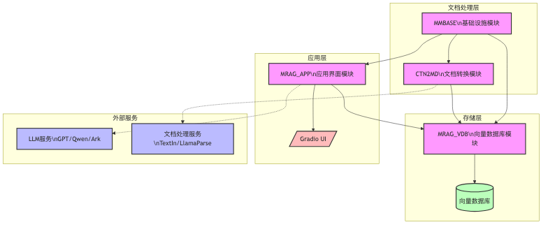
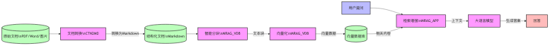
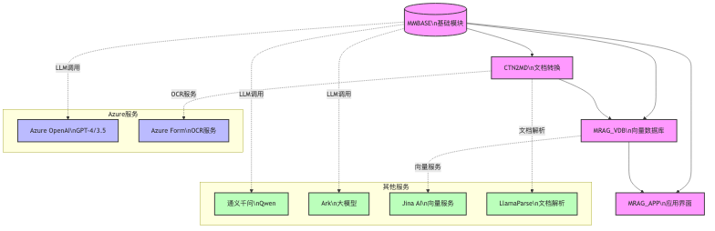

# MultiModal_Rag

一个完整的多模态 RAG (Retrieval-Augmented Generation) 系统，包含文档转换、向量数据库存储和 Gradio 交互界面。 -- 用CURSOR编写的，大致没错。

** 重要 配置.env 环境变量 ** 
需要 .env 里面有这么一行：
```
  PYTHONPATH=.
```
所有的代码基本都附带有一个简单的测试，需要知道项目的根目录在哪里才能执行。

## 系统架构图



*图1: 系统整体架构图，展示了主要组件和它们之间的关系*



*图2: 数据流向图，展示了从文档输入到答案生成的完整流程*



*图3: 模块依赖关系图，展示了内部模块之间的依赖关系以及与外部服务的集成*

## 典型使用场景

### 1. 技术文档智能问答
适用于将大量技术文档（如API文档、产品手册）转换为智能问答系统。

```python
# 1. 转换文档
from ctn2md.ctn2md_converter_ti import do_content2md_convert
do_content2md_convert("technical_docs/")

# 2. 构建知识库
from mrag_vdb.batch_docs_to_vdb_mrag import upsert_batch_kbname_to_vdb
upsert_batch_kbname_to_vdb("technical_docs/", "tech_kb")

# 3. 启动问答界面
python mrag_app/app_gradio.py
```

### 2. 多模态产品资料检索
适用于包含图文混合的产品资料，支持图片关联的智能问答。

```python
# 1. 转换产品资料（支持图文）
from ctn2md.ctn2md_converter_lvlm import do_content2md_convert
do_content2md_convert("product_docs/")

# 2. 构建多模态知识库
from mrag_vdb.batch_docs_to_vdb_mrag import upsert_batch_kbname_to_vdb
upsert_batch_kbname_to_vdb("product_docs/", "product_kb", 
                          image_enabled=True)

# 3. 启动带图片支持的问答界面
python mrag_app/app_gradio.py
```

### 3. 实时文档更新和问答
适用于需要频繁更新的知识库场景。

```python
# 1. 监控文档变化
from ctn2md.ctn2md_watcher import start_doc_watcher
start_doc_watcher("live_docs/")

# 2. 增量更新知识库
from mrag_vdb.incremental_update import update_changed_docs
update_changed_docs("live_docs/", "live_kb")

# 3. 启动实时问答界面
python mrag_app/app_gradio.py
```

## 系统架构

该项目由四个主要模块组成：

### 1. [MMBASE](mmbase/README_MMBASE.md) (MultiModal Base)
- 基础工具和共享功能
  - 统一日志系统
  - LLM 交互基础设施
  - 监控和性能追踪
  - 通用工具函数
- LLM 服务适配
  - OSS/TOS 实现支持
  - 消息处理工具
  - 服务监控和日志
- 必须记得用安装本地
  - 在根目录直接 `pip install -e ./mmbase` 安装


### 2. [CTN2MD](ctn2md/README_CTN2MD.md) (Content to Markdown)
- 多引擎文档转换系统
  - LVLM (Large Vision Language Model) 模式
  - TextIn OCR 模式
  - LlamaParse 模式
- 智能文档结构化
  - 自动标题层级优化
  - 内容智能分段
  - 图文关联分析
- 批量处理能力
  - 多格式文档支持
  - 转换进度监控
  - 可配置参数

### 3. [MRAG_VDB](mrag_vdb/README_MRAG_VDB.md) (MultiModal RAG Vector Database)
- 文档向量化与存储
  - 智能文档分块
  - 向量数据持久化
  - 多知识库管理
- 高级检索功能
  - 混合检索策略
  - 可配置权重系统
  - 重排序支持
- 性能优化
  - 批量处理
  - 异步操作
  - 缓存机制

### 4. [MRAG_APP](mrag_app/README_MRAG_APP.md) (MultiModal RAG Application)
- Web 交互界面
  - 基于 Gradio 构建
  - 实时进度显示
  - 美观的 UI 设计
- 多模型支持
  - GPT-4/3.5 系列
  - Qwen (通义千问)
  - Ark
  - 本地模型
- 知识库管理
  - 多知识库切换
  - 检索参数配置
  - 历史记录追踪

## 快速开始

### 环境准备

1. 安装基础依赖
```bash
pip install -r requirements.txt
```

2. 安装开发依赖（可选）
```bash
pip install -r requirements-dev.txt
```

### 基本使用流程

1. 文档转换
```python
from ctn2md.ctn2md_converter_ti import do_content2md_convert
do_content2md_convert("your_doc.pdf")
```

2. 向量数据库处理
```python
from mrag_vdb.batch_docs_to_vdb_mrag import upsert_batch_kbname_to_vdb
upsert_batch_kbname_to_vdb("path/to/docs", "kb_name")
```

3. 启动应用界面
```python
python mrag_app/app_gradio.py
```

## 配置说明

项目使用 `.env` 文件管理配置，主要包括：
- 模型服务访问配置（GPT/Qwen/Ark）
- API 密钥配置
- Python 路径配置

## 系统要求

- Python 3.12+
- 足够的系统内存（建议 16GB+）
- 支持的模型服务
  - GPT/Qwen/Ark 等 LLM
  - TextIn API（可选）
  - LlamaParse（可选）

## 开发指南

详细的开发文档请参考各模块的 README：
- [MMBASE 开发文档](mmbase/README_MMBASE.md)
- [CTN2MD 开发文档](ctn2md/README_CTN2MD.md)
- [MRAG_VDB 开发文档](mrag_vdb/README_MRAG_VDB.md)
- [MRAG_APP 开发文档](mrag_app/README_MRAG_APP.md)
- [环境配置说明](README_MRAG_ENV.md)
- [测试说明](README_MRAG_PYTEST.md)

## CURSOR project 
Codelf is a powerful AI-assisted coding tool that provides better code understanding and modification capabilities for AI agents through the Model Context Protocol (MCP).
 - https://github.com/Disdjj/codelf
