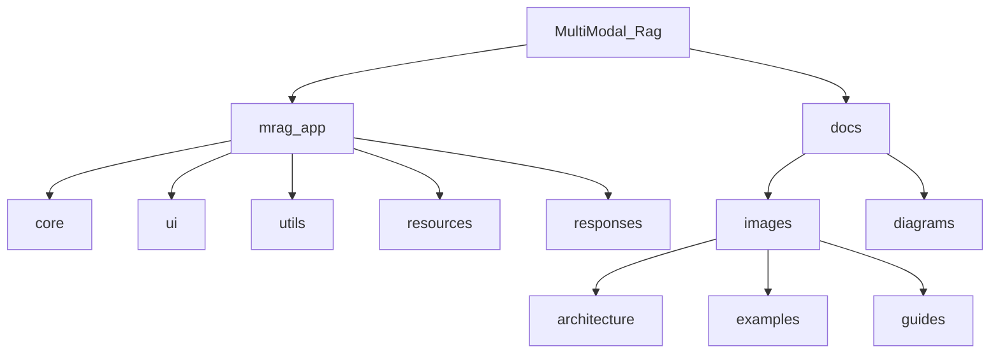
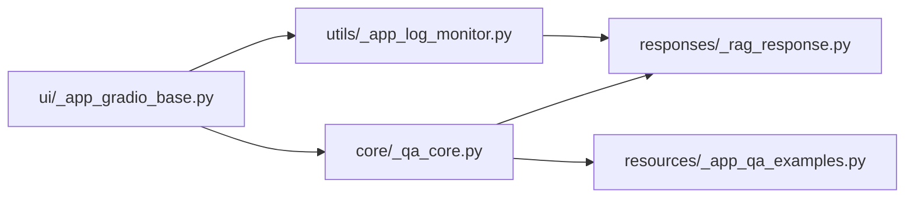
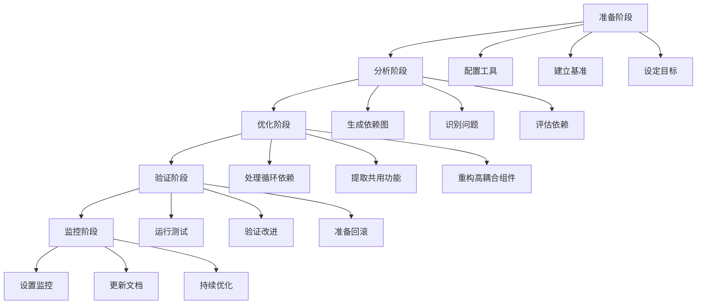
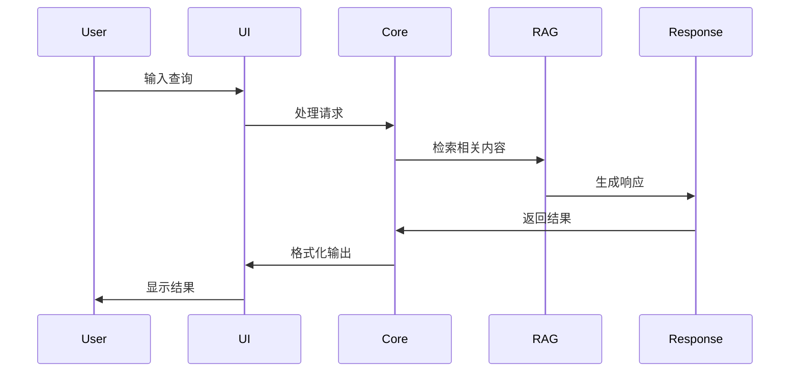

# 项目文档目录

本目录包含项目的补充文档和资源。

## 目录结构

- `images/` - 文档使用的图片资源
  - `architecture/` - 系统架构相关图片
  - `examples/` - 使用示例和截图
  - `guides/` - 使用指南相关图片

## 图片命名规范

- 架构图: `arch_[module]_[description].png`
- 示例图: `example_[feature]_[description].png`
- 指南图: `guide_[topic]_[step].png`

## 项目可视化

### 项目结构

### 模块依赖关系

### 重构流程

### 数据流程

## 说明
以上图表使用 Mermaid 语法生成，可在支持 Mermaid 的 Markdown 查看器中直接预览（如 GitHub、VS Code 等）。图表展示了项目的整体结构、模块依赖关系、重构流程以及系统数据流向，帮助开发者更好地理解项目架构。 